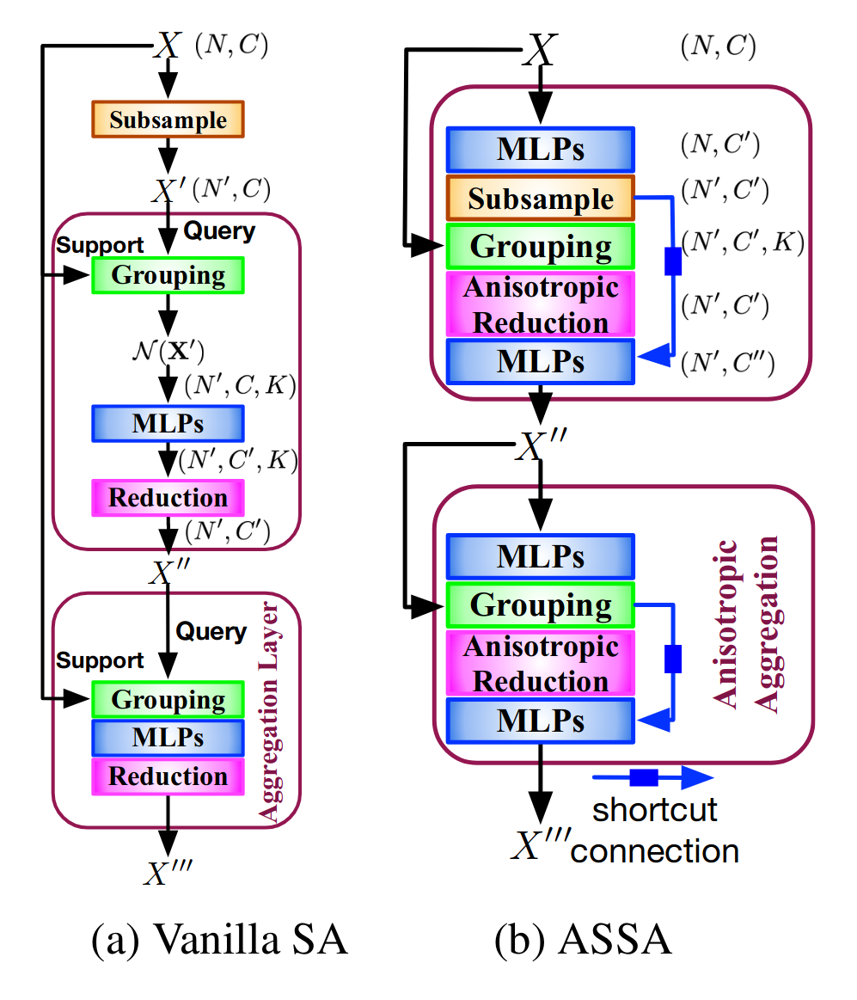
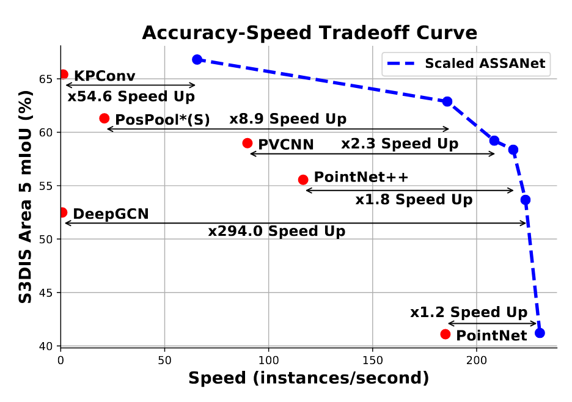

# ASSANet

[arXiv](https://arxiv.org/abs/2110.10538) | [Supplementary](https://github.com/guochengqian/ASSANet/blob/main/misc/ASSANet_supplementary.pdf) | [New version of ASSANet Implementation](https://github.com/guochengqian/PointNeXt)

This is official repository of NeurIPS 2021 spotlight paper: [ASSANet: An Anisotropical Separable Set Abstraction forEfficient Point Cloud Representation Learning](https://arxiv.org/abs/2110.10538).  

<p float="middle">
    
     
</p>

## This repo is deprecated Please refer to [PointNeXt](https://github.com/guochengqian/PointNeXt) for the latest code of ASSANet

# Cite

```
@inproceedings{qian2021assanet,
  title={ASSANet: An Anisotropical Separable Set Abstraction for Efficient Point Cloud Representation Learning},
  author={Qian, Guocheng and Hammoud, Hasan and Li, Guohao and 
          Thabet, Ali and Ghanem, Bernard},
  booktitle={Advances in Neural Information Processing Systems (NeurIPS)},
  year={2021}
}
```

